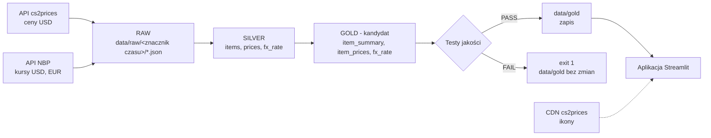

# Porównywarka cen przedmiotów CS2

Lokalna aplikacja demonstracyjna, która pozwala sprawdzić, na którym rynku dany przedmiot
z gry Counter-Strike 2 jest najtańszy.

Projekt składa się z dwóch części:

1. **Potok danych** (`run_pipeline.py`): pobiera ceny z API i kursy walut,
   zapisuje dane surowe, czyści je, rozbija nazwy przedmiotów na części, liczy podsumowania
   i uruchamia testy jakości danych.
2. **Aplikacja** (`app.py`, Streamlit): wyszukiwarka i lista przedmiotów z filtrami oraz
   porównanie cen na wszystkich rynkach z odnośnikami do ofert.

Aplikacja nie odpytuje API przy każdym otwarciu. Czyta wynik ostatniego poprawnego
uruchomienia potoku (`data/gold`).

---

## Spis treści

- [Odbiorca i pytania](#odbiorca-i-pytania)
- [Źródła danych](#źródła-danych)
- [Architektura i przepływ danych](#architektura-i-przepływ-danych)
- [Warstwy danych](#warstwy-danych)
- [Parsowanie nazw przedmiotów](#parsowanie-nazw-przedmiotów)
- [Przeliczanie walut](#przeliczanie-walut)
- [Testy jakości danych](#testy-jakości-danych)
- [Aplikacja](#aplikacja)
- [Struktura repozytorium](#struktura-repozytorium)
- [Instalacja i uruchomienie](#instalacja-i-uruchomienie)
- [Konfiguracja](#konfiguracja)
- [Ograniczenia](#ograniczenia)

---

## Odbiorca i pytania

**Odbiorca:** gracz CS2, który chce kupić konkretny przedmiot i nie chce ręcznie sprawdzać
kilku serwisów handlowych.

**Pytania, na które odpowiadają dane:**

1. Na którym rynku dany przedmiot jest teraz najtańszy i ile kosztuje?
2. Jak duża jest różnica cen tego samego przedmiotu między rynkami?
3. Ile kosztuje przedmiot w PLN (lub EUR) po aktualnym kursie NBP?
4. Jak wypada cena konkretnego wariantu (StatTrak™ / Souvenir / stan zużycia) na tle pozostałych?

---

## Źródła danych

| Źródło | Endpoint | Co dostarcza | Uwierzytelnienie |
|---|---|---|---|
| cs2prices | `GET https://api.cs2prices.net/v1/market/prices?currency=usd` | najniższa cena i liczba ofert każdego przedmiotu na 5 rynkach: Buff163, YouPin, CSFloat, Market.CSGO, CSGORoll (~38 tys. przedmiotów, ~133 tys. ofert) | nagłówek `x-api-key` |
| NBP | `GET https://api.nbp.pl/api/exchangerates/rates/a/usd/?format=json` | średni kurs USD/PLN (tabela A) | brak |
| NBP | `GET https://api.nbp.pl/api/exchangerates/rates/a/eur/?format=json` | średni kurs EUR/PLN (tabela A) | brak |
| cs2prices CDN | `https://cdn.cs2prices.net/icons/<slug>.png` | ikony przedmiotów | brak |

Format odpowiedzi cs2prices (ceny w centach):

```json
{
  "currency": "USD",
  "items": {
    "AK-47 | Redline (Field-Tested)": {
      "csfloat": {"price": 2270, "listing_count": 3796},
      "youpin":  {"price": 2319, "listing_count": 11520}
    }
  }
}
```

NBP publikuje kursy tabeli A w dni robocze. W weekend i święta API zwraca ostatni
opublikowany kurs, którego data jest zapisywana w danych (`effective_date`).

---

## Architektura i przepływ danych



Kroki wykonywane przez `run_pipeline.py`:

| Krok | Moduł | Co robi |
|---|---|---|
| 1/4 RAW | `pipeline/extract.py` | Pobiera 3 odpowiedzi API i zapisuje je 1:1 w nowym katalogu `data/raw/<RRRR-MM-DDTHH-MM-SS>/`. Każde uruchomienie tworzy osobny katalog, więc historia pobrań jest zachowana. |
| 2/4 SILVER | `pipeline/transform.py` | Spłaszcza zagnieżdżony JSON do tabeli (przedmiot, rynek), zamienia centy na dolary, przelicza ceny na EUR i PLN, rozbija nazwy przedmiotów na części. |
| 3/4 GOLD | `pipeline/transform.py` | Dla każdego przedmiotu liczy najniższą i najwyższą cenę, najtańszy rynek, liczbę rynków, łączną liczbę ofert i różnicę cen w %. |
| 4/4 Testy | `pipeline/quality.py` | Uruchamia testy jakości. Dopiero gdy wszystkie przejdą, tabele są zapisywane do `data/silver` i `data/gold`. |

---

## Warstwy danych

Wszystkie tabele SILVER i GOLD są zapisywane w formacie Parquet.

### RAW: `data/raw/<znacznik czasu>/`

| Plik | Zawartość |
|---|---|
| `cs2prices_usd.json` | surowa odpowiedź cs2prices |
| `nbp_usd.json` | surowa odpowiedź NBP dla USD |
| `nbp_eur.json` | surowa odpowiedź NBP dla EUR |

### SILVER: `data/silver/`

**`items`**: jeden wiersz na przedmiot.

| Kolumna | Typ | Opis |
|---|---|---|
| `item_name` | tekst | pełna nazwa rynkowa (klucz), np. `StatTrak™ AK-47 \| Redline (Field-Tested)` |
| `category` | tekst | `Broń` (bronie, noże, rękawice) lub `Inne` (naklejki, skrzynki, graffiti, charmy, agenci…) |
| `special_condition` | tekst / brak | `StatTrak™`, `Souvenir`, `★`, `★ StatTrak™` lub brak |
| `weapon` | tekst / brak | np. `AK-47`, `Karambit`, `Sport Gloves` |
| `skin` | tekst / brak | np. `Redline`; brak dla „gołego” noża (`★ Bayonet`) |
| `wear` | tekst / brak | `Factory New`, `Minimal Wear`, `Field-Tested`, `Well-Worn`, `Battle-Scarred` |
| `phase` | tekst / brak | faza Dopplera, np. `Phase 2`, `Sapphire`, `Emerald` |

Dla kategorii `Inne` kolumny `special_condition`…`phase` są puste.

**`prices`**: jeden wiersz na parę (przedmiot, rynek).

| Kolumna | Typ | Opis |
|---|---|---|
| `item_name` | tekst | nazwa przedmiotu (→ `items.item_name`) |
| `market` | tekst | `buff163`, `youpin`, `csfloat`, `marketcsgo`, `csgoroll` |
| `price_usd` | liczba | najniższa cena na rynku w USD (z API, centy / 100) |
| `price_pln` | liczba | `price_usd × kurs USD/PLN`, zaokrąglone do 0,01 |
| `price_eur` | liczba | `price_usd × kurs USD/PLN / kurs EUR/PLN`, zaokrąglone do 0,01 |
| `listing_count` | liczba całkowita | liczba ofert sprzedaży na rynku |

**`fx_rate`**: kursy użyte do przeliczenia.

| Kolumna | Opis |
|---|---|
| `currency` | `USD` lub `EUR` |
| `pln_per_unit` | kurs średni NBP (ile PLN za 1 jednostkę waluty) |
| `effective_date` | data publikacji kursu |
| `table_no` | numer tabeli NBP, np. `226/A/NBP/2026` |

### GOLD: `data/gold/`

**`item_summary`**: kolumny z `items` oraz:

| Kolumna | Opis |
|---|---|
| `min_price_usd` | najniższa cena spośród wszystkich rynków |
| `max_price_usd` | najwyższa z najniższych cen na poszczególnych rynkach |
| `best_market` | rynek z najniższą ceną |
| `markets_count` | na ilu rynkach przedmiot jest dostępny |
| `total_listings` | suma ofert ze wszystkich rynków (miara popularności / płynności) |
| `spread_pct` | `(max / min − 1) × 100`, czyli o ile % najdroższy rynek przebija najtańszy |

**`item_prices`**: kopia `silver/prices` używana w widoku szczegółów.

**`fx_rate`**: kopia `silver/fx_rate` (aplikacja pokazuje kurs i jego datę).

**`source_run.txt`**: nazwa katalogu RAW, z którego powstały dane w `gold`.

---

## Parsowanie nazw przedmiotów

Nazwy broni mają postać:

```
<special condition> <weapon> | <skin> (<wear>) [- <phase>]
```

| Nazwa | special_condition | weapon | skin | wear | phase |
|---|---|---|---|---|---|
| `AK-47 \| Redline (Field-Tested)` | – | AK-47 | Redline | Field-Tested | – |
| `StatTrak™ AK-47 \| Redline (Minimal Wear)` | StatTrak™ | AK-47 | Redline | Minimal Wear | – |
| `Souvenir AWP \| Dragon Lore (Factory New)` | Souvenir | AWP | Dragon Lore | Factory New | – |
| `★ StatTrak™ Survival Knife \| Doppler (Factory New) - Sapphire` | ★ StatTrak™ | Survival Knife | Doppler | Factory New | Sapphire |
| `★ Bayonet` | ★ | Bayonet | – | – | – |
| `Sticker \| 9INE (Holo) \| Paris 2023` | kategoria `Inne` | | | | |

Reguła klasyfikacji (`parse_name` w `pipeline/transform.py`): przedmiot jest **bronią**, jeśli
kończy się jednym z pięciu stanów zużycia (opcjonalnie z fazą) **albo** zaczyna się od `★`
i nie ma skina (nóż/rękawice bez skina). Wszystko inne trafia do kategorii **Inne**.
Dzięki temu np. `Souvenir Charm | …` czy `Sticker | … (Holo) | …` nie są mylnie
rozpoznawane jako broń.

---

## Przeliczanie walut

- Ceny pobierane są z cs2prices **tylko w USD**.
- PLN = USD × kurs średni NBP USD/PLN.
- EUR = USD × (USD/PLN) / (EUR/PLN), czyli kurs krzyżowy przez złotówkę.

**Dlaczego nie `currency=eur` z API?** Dwa osobne zapytania (USD i EUR) to dwa różne
zrzuty rynku. W testach ok. 480 ofert występowało tylko w jednym z nich, co powodowało
braki w danych. Jedno zapytanie + kursy NBP daje spójny zestaw cen.

---

## Testy jakości danych

Testy znajdują się w `pipeline/quality.py` i są uruchamiane na dwa sposoby:

1. **Automatycznie na końcu potoku.** Każdy test wypisuje `[PASS]` lub `[FAIL]` z opisem błędów.
   Jeśli którykolwiek nie przejdzie, potok kończy się kodem wyjścia `1` i **nie nadpisuje**
   `data/gold`, więc aplikacja nadal pokazuje ostatnie poprawne dane.
2. **Przez `pytest`** (`tests/test_quality.py`) na aktualnej zawartości `data/gold`.

| Test | Rodzaj reguły | Sprawdza |
|---|---|---|
| `check_unique_item_market` | unikalność | para (przedmiot, rynek) występuje raz |
| `check_unique_item` | unikalność | przedmiot występuje raz w `item_summary` |
| `check_completeness` | kompletność | brak pustych wartości w nazwie, rynku i cenach; każda broń ma nazwę broni |
| `check_allowed_values` | dozwolone wartości | rynek ∈ 5 znanych, kategoria ∈ {Broń, Inne}, stan zużycia ∈ 5 znanych |
| `check_price_range` | zakres | ceny > 0; są oba kursy NBP; kursy w przedziale 2–8 PLN |
| `check_referential_integrity` | integralność referencyjna | każda cena wskazuje na istniejący przedmiot |
| `check_domain_rules` | reguły dziedzinowe | min ≤ max; `best_market` ma faktycznie najniższą cenę; przedmiot nie jest jednocześnie Souvenir i StatTrak™ |

Dodatkowo `tests/test_parse_name.py` zawiera testy jednostkowe parsowania nazw
(StatTrak™, Souvenir, noże z fazą, „goły” nóż, naklejki, charmy, kapsuły).

Przykładowy wynik potoku:

```
4/4 Testy jakości danych
  [PASS] check_unique_item_market: Unikalność: para (przedmiot, rynek) występuje raz.
  [PASS] check_unique_item: Unikalność: przedmiot występuje raz w podsumowaniu.
  [PASS] check_completeness: Kompletność: kluczowe kolumny nie mają braków.
  ...
OK: 38363 przedmiotów, 132873 ofert -> data/gold
```

---

## Aplikacja

Uruchamiana poleceniem `streamlit run app.py`, domyślnie pod `http://localhost:8501`.
Czyta wyłącznie tabele z `data/gold`.

### Panel filtrów (po lewej)

| Filtr | Działanie |
|---|---|
| **Waluta** | USD / EUR / PLN; wszystkie ceny na stronie są przeliczane |
| **Rynki** | checkboxy dla 5 rynków. Najniższa cena, najtańszy rynek i różnica cen są liczone **tylko z zaznaczonych rynków**. Przedmioty niedostępne na żadnym z nich znikają z listy. |
| **Cena** | minimalna / maksymalna najniższa cena, w wybranej walucie |
| **Stan zużycia** | FN, MW, FT, WW, BS (można zaznaczyć kilka) |
| **StatTrak™** / **Souvenir** | Dowolne / Tylko / Bez |
| **Kategoria** | Wszystkie / Broń / Inne |

Pod filtrami widać datę pobrania danych oraz użyte kursy NBP z datą publikacji.

### Lista wyników

- Wyszukiwarka nad listą dopasowuje **wszystkie wpisane słowa** w dowolnej kolejności,
  bez rozróżniania wielkości liter (np. `redline ak` znajdzie `AK-47 | Redline`).
- Sortowanie: popularność (łączna liczba ofert), cena rosnąco/malejąco, różnica cen, nazwa.
- Każdy wiersz zawiera:
  - ikonę przedmiotu,
  - nazwę i odznaki: `ST` (StatTrak™), `SV` (Souvenir), stan zużycia, `INNE`,
  - najniższą cenę i pod nią najwyższą („do …”),
  - najtańszy rynek i informację, spośród ilu rynków był najtańszy.
- Wyniki są dzielone na strony po 50 pozycji. Zmiana filtrów wraca na stronę 1.

### Okno porównania rynków

Po kliknięciu nazwy przedmiotu otwiera się okno z kartą dla każdego rynku (posortowane od
najtańszego). Karta zawiera:

- cenę w wybranej walucie i dodatkowo w PLN (lub w USD, gdy wybrano PLN),
- oznaczenie **Najniżej** (zielona ramka) albo różnicę procentową względem najtańszego rynku,
- liczbę ofert,
- przycisk **Zobacz oferty ↗** otwierający ofertę na stronie rynku.

Odnośniki są budowane z nazwy przedmiotu (`market_url` w `app.py`):

| Rynek | Format odnośnika |
|---|---|
| CSFloat | `https://csfloat.com/search?sort_by=lowest_price&type=buy_now&market_hash_name=<nazwa>` |
| Market.CSGO | `https://market.csgo.com/en/?search=<nazwa>&quality=<stan zużycia>` |
| CSGORoll | `https://www.csgoroll.com/trade/market/?marketName=<nazwa>` |
| Buff163 | `https://buff.163.com/market/csgo#game=csgo&page_num=1&search=<nazwa>` (wyszukiwarka, wymaga zalogowania) |
| YouPin | brak: rynek identyfikuje przedmioty wewnętrznym ID, którego API nie udostępnia |

### Ikony

Ikony pobierane są przez przeglądarkę z CDN cs2prices. Nazwa pliku powstaje z nazwy
przedmiotu (`icon_url` w `app.py`): małe litery, każdy ciąg znaków spoza `a-z0-9` zamieniony
na `-`, myślniki z początku i końca usunięte.

```
★ StatTrak™ Karambit | Tiger Tooth (Factory New)
→ https://cdn.cs2prices.net/icons/stattrak-karambit-tiger-tooth-factory-new.png
```

---

## Struktura repozytorium

```
.
├── pipeline/
│   ├── __init__.py
│   ├── config.py        ścieżki warstw, adresy API, dozwolone rynki/stany/kategorie
│   ├── extract.py       RAW: pobranie danych z API i zapis bez zmian
│   ├── transform.py     SILVER i GOLD: spłaszczenie, przeliczenie walut, parsowanie nazw, agregacje
│   └── quality.py       testy jakości danych + raport PASS/FAIL
├── tests/
│   ├── test_quality.py      testy jakości uruchamiane przez pytest na data/gold
│   └── test_parse_name.py   testy jednostkowe parsowania nazw
├── .streamlit/
│   └── config.toml      ciemny motyw aplikacji
├── run_pipeline.py      punkt wejścia potoku
├── app.py               aplikacja Streamlit
├── requirements.txt     zależności Pythona
├── pytest.ini           konfiguracja pytest
├── .env.example         przykładowa konfiguracja (bez sekretów)
├── .gitignore           wyklucza .env, .venv, data/ i pliki tymczasowe
└── data/                tworzone przez potok, nie trafia do repozytorium
    ├── raw/<znacznik czasu>/
    ├── silver/
    └── gold/
```

---

## Instalacja i uruchomienie

### Wymagania

- Python 3.11 lub nowszy
- dostęp do internetu (API cs2prices, API NBP, CDN z ikonami)
- klucz API cs2prices

Polecenia poniżej są dla PowerShell (Windows). Na Linux/macOS aktywacja środowiska to
`source .venv/bin/activate`, a kopiowanie pliku `cp .env.example .env`.

### 1. Środowisko i zależności

```powershell
python -m venv .venv
.venv\Scripts\Activate.ps1
pip install -r requirements.txt
```

Instalowane biblioteki: `requests` (pobieranie z API), `pandas` + `pyarrow` (transformacje
i Parquet), `streamlit` (aplikacja), `python-dotenv` (odczyt `.env`), `pytest` (testy).

### 2. Konfiguracja klucza API

```powershell
copy .env.example .env
```

Następnie w pliku `.env` wpisz swój klucz w miejsce `twoj_klucz_api`.

### 3. Uruchomienie potoku

```powershell
python run_pipeline.py
```

Pobranie trwa zwykle kilka–kilkanaście sekund (odpowiedź cs2prices ma ok. 7 MB).
Aby przetworzyć ponownie ostatnio pobrane dane **bez** odpytywania API (np. po zmianie
transformacji), użyj:

```powershell
python run_pipeline.py --no-fetch
```

Kod wyjścia: `0`, gdy wszystko przeszło; `1`, gdy testy jakości nie przeszły
(wtedy `data/gold` pozostaje bez zmian).

### 4. Testy

```powershell
pytest
```

Testy jakości są pomijane (`skipped`), jeśli `data/gold` jeszcze nie istnieje,
więc najpierw uruchom potok.

### 5. Aplikacja

```powershell
streamlit run app.py
```

Aplikacja otworzy się w przeglądarce pod `http://localhost:8501`. Dane są buforowane
w pamięci (`st.cache_data`), a bufor jest unieważniany, gdy zmieni się plik w `data/gold`.
Po ponownym uruchomieniu potoku wystarczy odświeżyć stronę; serwera nie trzeba restartować.

---

## Konfiguracja

| Zmienna (`.env`) | Wymagana | Opis |
|---|---|---|
| `CS2PRICES_API_KEY` | tak | klucz do API cs2prices, wysyłany w nagłówku `x-api-key` |

Pozostałe ustawienia (adresy API, timeout zapytań = 60 s, listy dozwolonych rynków,
stanów zużycia i kategorii) znajdują się w `pipeline/config.py`.

---

## Ograniczenia

- **Brak historii cen w aplikacji.** Każde uruchomienie potoku zapisuje nowy katalog RAW,
  ale SILVER i GOLD zawierają tylko najnowszy stan. Aplikacja nie pokazuje trendów.
- **Cena = najniższa oferta.** API zwraca tylko najniższą cenę na rynku, bez rozkładu ofert,
  float czy naklejek na konkretnym egzemplarzu.
- **Kurs średni NBP ≠ kurs rynku.** Przeliczenia na PLN/EUR są orientacyjne; rynki stosują
  własne kursy i prowizje, których projekt nie uwzględnia.
- **Kategoria „Inne” nie jest dzielona dalej.** Naklejki, skrzynki, graffiti, charmy
  i agenci są w jednej kategorii (szukać ich można po nazwie).
- **Odnośniki:** YouPin nie ma odnośnika (brak ID przedmiotu), Buff163 prowadzi do
  wyszukiwarki i wymaga zalogowania.
- **Ikony:** nazwa pliku ikony jest wyliczana regułą ustaloną na próbce. Pojedyncze
  przedmioty o nietypowych nazwach mogą nie mieć ikony.
- **Brak harmonogramu.** Potok uruchamia się ręcznie.

---

## Autorzy

Przygotowane przez: Michał Golina, Taron Tovmasyan
